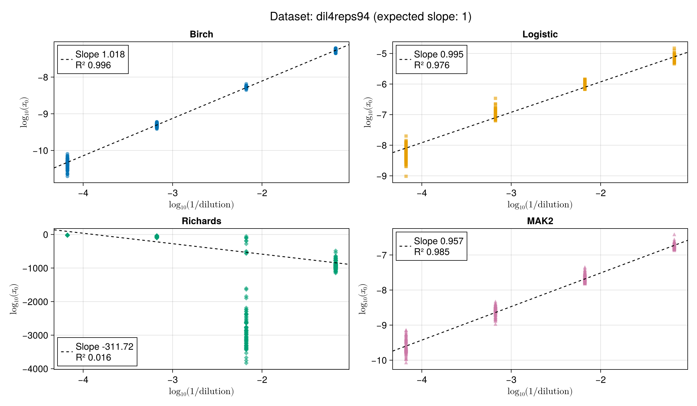
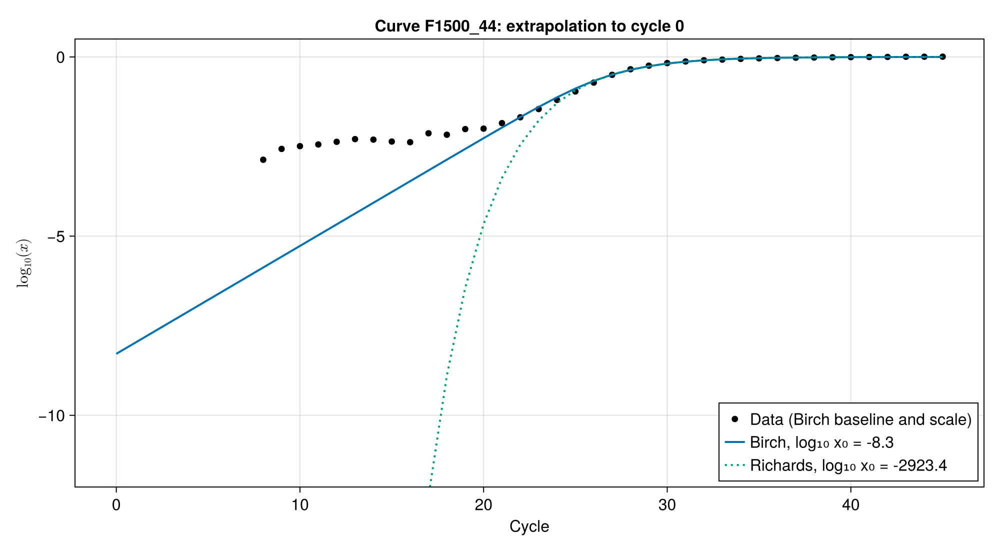

# qPCRModels.jl

[](https://gschivre.github.io/qPCRModels.jl/dev/)
[](https://github.com/gschivre/qPCRModels.jl/actions/workflows/CI.yml?query=branch%3Amain)

`qPCRModels.jl` is a Julia package that fits qPCR fluorescence amplification curves with non-linear least squares. It implements:

| Model | Type | Fitted range | Non-linear parameters |
|---|---|---|---|
| `BirchModel` | mechanistic | **whole curve** | $b$, $t_m$ |
| `MAK2Model` | mechanistic | exponential phase only (up to the SDM) | $x_0$ |
| `LogisticModel` | empirical (4PL) | whole curve | $a$, $t_m$ |
| `RichardsModel` | empirical (5PL) | whole curve | $a$, $t_m$, $\nu$ |

Every model has the form $F(c) = F_\mathrm{bg} + F_\mathrm{max} x(c)$, where $c$ is the cycle number. The baseline $F_\mathrm{bg}$ and scale $F_\mathrm{max}$ are linear parameters, eliminated by Variable Projection, so the Levenberg–Marquardt optimiser only searches over the non-linear parameters.

## Why the Birch model?

Mechanistic models such as MAK2 (Boggy & Woolf, *PLoS ONE* 2010) estimate the initial target quantity directly from reaction kinetics, with no standard curve and no efficiency assumption from a threshold. However, MAK2 describes only the start of the reaction, so it must be truncated near the second-derivative maximum and ignores most of the data. Empirical sigmoids (4PL/5PL) fit the whole curve, but their parameters have no physical meaning, so $x_0$ cannot be read from them in a principled way.

The Birch model has the strengths of both:

* it is **derived from the PCR reaction scheme** (primer annealing competing with template re-annealing), so its parameters have a physical meaning;
* it describes **the whole curve**, from the exponential phase through the slowdown and up to the plateau, so every cycle informs the fit;
* it needs just **two non-linear parameters** ($b$ and $t_m$). This is the same number as the 4PL, and one fewer than the 5PL, yet the curve can still be asymmetric.

## Derivation of the Birch model

### Reaction scheme

| Symbol | Species |
|---|---|
| $A$ | single-stranded target DNA (ssDNA, after denaturation) |
| $B$ | primer |
| $S$ | primed template (ssDNA + annealed primer) |
| $P$ | double-stranded DNA (dsDNA), which is the fluorescent product |
| $E$ | polymerase |

During the annealing/extension step of each cycle, every single strand $A$ has two possible fates:

1. **Productive annealing then extension**: $A + B \to S$, then $S + E \to ES \to P + E$. The strand is copied, so one new strand is created (and one primer is used up).
2. **Non-productive re-annealing**: $A + A \to P$. The strand re-hybridises with its complementary strand, no copy is made, and no primer is used.

### Hypotheses

**H1 – Non-limiting polymerase.** $E$ is in excess and extension is fast compared with annealing. $S$ is therefore in quasi-steady state ($d[S]/dt \approx 0$) and every primed template is extended within the cycle. Annealing and extension can be lumped into a single step.

**H2 – Complete denaturation.** At the start of each cycle, all target DNA is single-stranded: $[A] = n$, where $n$ is the number of target strands.

**H3 – Primers are the limiting resource.** Each new strand uses one primer, so $[B] = B_0 - (n - n_0)$. Defining the **carrying capacity**

$$
K = B_0 + n_0
$$

the free primer pool is simply $[B] = K - n$. The plateau is reached when the primers are exhausted ($n \to K$).

**H4 – Kinetic partition.** Within an annealing step, a strand's fate is set by the ratio of the two competing rates. These rates are evaluated with the concentrations at the start of the step:

$$
\text{primer annealing: } k_1 [A][B], \qquad \text{re-annealing: } k_2 [A]^2.
$$

The fraction of strands that get copied, i.e. the per-cycle efficiency, is therefore

$$
\varphi(n) = \frac{k_1 [A][B]}{k_1 [A][B] + k_2 [A]^2} = \frac{k_1 (K - n)}{k_1 (K - n) + k_2 n}.
$$

**H5 – Continuous-cycle approximation.** The cycle number $c$ is treated as continuous. The mechanistic per-cycle update $n_{c+1} = (1 + E_\mathrm{max} \varphi) n_c$ is replaced by $d \ln n / dc = a \varphi$, where $a = \ln(1 + E_\mathrm{max})$. This package assumes perfect doubling at low template ($E_\mathrm{max} = 1$, $a = \ln 2$), as MAK2 does. See [Discrete cycles vs continuous time](#discrete-cycles-vs-continuous-time) for what this approximation does and does not change.

**H6 – Fluorescence is proportional to product.** After extension, every strand (copied or re-annealed) sits in a duplex, so $[P] \propto n$ and $F = F_\mathrm{bg} + F_\mathrm{max} n/K$.

### From the scheme to the ODE

Combining H4 and H5:

$$
\frac{dn}{dc} = a n \varphi(n) = \frac{a k_1 n (K - n)}{k_1 K + (k_2 - k_1) n}.
$$

Dividing the numerator and denominator by $k_1$ and setting

$$
b = \frac{k_2}{k_1} - 1
$$

gives the **Birch** growth equation (Birch, *Ann. Bot.* 1999):

$$
\boxed{\frac{dn}{dc} = \frac{a n (K - n)}{K + b n}}
$$

or, for the normalised quantity $x = n/K \in (0, 1)$,

$$
\frac{dx}{dc} = \frac{a x (1 - x)}{1 + b x}.
$$

### Discrete cycles vs continuous time

PCR runs in discrete cycles, but the Birch model is an ODE. The ODE is **autonomous**: its right-hand side depends on $n$ only, not on $c$. Two consequences follow:

* **No discretisation error.** Sampled at whole cycles, the ODE solution follows *exactly* a recursion $x_{c+1} = \Phi(x_c)$, where $\Phi$ is the solution map over one cycle. $\Phi$ is the same for every cycle, so fitting the continuous solution at integer cycles is fitting a genuine cycle-to-cycle model with constant reaction conditions.
* **Changing $a$ only rescales time.** At low template, $\Phi(x) \to (1 + E_\mathrm{max}) x$ exactly, so $a = \ln(1 + E_\mathrm{max})$ reproduces the per-cycle efficiency of the exponential phase with no approximation.

However, $\Phi$ is **not** the mechanistic update $x + E_\mathrm{max} \varphi(x) x$, and no time rescaling can make the two equal, because the required factor changes along the curve. For the logistic case ($b = 0$, $a = \ln 2$), $\Phi(x) = 2x/(1 + x)$ (the Beverton–Holt map). Its per-cycle efficiency is $(1 - x)/(1 + x)$, compared with $\varphi = 1 - x$ from the kinetic partition (1/3 vs 1/2 at half-plateau). The two agree exactly at the start (efficiency $E_\mathrm{max}$) and at the plateau (efficiency 0), and differ in between.

**The rate must set the time scale.** The same reasoning explains how `MAK2Model` is implemented. Instead of iterating the MAK2 recursion $x_{c+1} = x_c + \ln(1 + x_c)$, it uses the implicit solution of the ODE $dx/dc = \ln 2 \cdot \ln(1 + x)$, which is convenient for sensitivity analysis. Writing $z = \ln(1 + x)$, that solution is $\mathrm{Ei}(z) - \mathrm{Ei}(z_0) = c \ln 2$. The $\ln 2$ factor matters. Without it, the ODE grows by a factor $e$ per cycle in the exponential phase instead of 2. The fitted $x_0$ then scales as $x_0^{1/\ln 2} \approx x_0^{1.44}$, which distorts fold changes, and it is a power law, not a constant rescaling. With it, the ODE and the recursion agree in the exponential phase, and $x_0$ differs from the recursion estimate only by a constant factor ($\approx 0.55$), which cancels in fold changes.

The Birch curve is therefore an exact, cycle-invariant model in its own right. The approximation lies only in its mechanistic reading: $b = k_2/k_1 - 1$ is a faithful summary of the competition between primer annealing and re-annealing, not an exact estimate of the rate-constant ratio.

### What the parameters mean

* **$K = B_0 + n_0$**: the plateau, set by the primer supply. Since the model is fitted on $x = n/K$ and the fluorescence scale is a linear parameter, $K$ never has to be known.
* **$a = \ln(1 + E_\mathrm{max})$**: the growth rate in early cycles, fixed to $\ln 2$. It sets the time scale and makes the early per-cycle growth exactly $1 + E_\mathrm{max}$.
* **$b = k_2/k_1 - 1 \gt -1$**: the competition parameter, which compares re-annealing with primer annealing. Because $k_2 \ge 0$, $b \gt -1$; the code enforces this through $b = e^{p} - 1$.
  * $b \to -1$ (no re-annealing): $dx/dc = a x$. The curve is purely exponential until the primers run out, then breaks sharply into the plateau.
  * $b = 0$ ($k_1 = k_2$): the classical **logistic** model, a symmetric sigmoid.
  * $b \gt 0$ (re-annealing is faster than priming): as product builds up, re-annealing increasingly wins over priming. Efficiency drops before primers are exhausted, which gives the long, asymmetric approach to the plateau seen in real qPCR curves.

The $b x$ term in the denominator is a **density-dependent inhibition**. It is the mechanistic counterpart of the empirical asymmetry factor $\nu$ in the Richards model.

### Closed-form (implicit) solution

The variables separate. With the partial fractions

$$
\frac{1 + b x}{x (1 - x)} = \frac{1}{x} + \frac{1 + b}{1 - x}
$$

integration gives

$$
\ln x - (1 + b) \ln(1 - x) = a c + C.
$$

The constant is fixed by $x(t_m) = 1/2$, so that $t_m$ is the half-amplification cycle. With $a = \ln 2$, this is the equation solved for each cycle in `src/models.jl`:

$$
\ln x - (1 + b) \ln(1 - x) = (c - t_m + b) \ln 2.
$$

For each cycle, the equation is solved for $\ln x$ with a safeguarded Newton solver (`newtsafe_rootfinding`). Working on the log scale keeps early cycles accurate even when $x$ is below $10^{-15}$. The Jacobian comes from implicit differentiation of the same relation.

### Derived quantities

* **Initial quantity** $x_0 = n_0/K$, obtained by solving the implicit equation at $c = 0$ (`get_x0`, `get_logx0`). It is the ratio of initial template strands to the total primer + template pool, and it is directly comparable between wells that share the same master mix.
* **Inflection point**: $x_i = 1/\left(1 + \sqrt{1 + b}\right)$. This is $1/2$ for the logistic case and lower for $b \gt 0$.
* **Cy₀** (Guescini et al., *BMC Bioinformatics* 2008): the intersection of the tangent at the inflection point with the baseline (`get_cy0`).

## Comparison on real data

The figures below use the `dil4reps94` dataset: four 10-fold dilutions with 94 replicates each. They are made by `examples/figures.jl`.

### Fit of one typical curve

All four models fitted to the same curve. MAK2 is fitted only up to the second-derivative maximum (dotted line). The 4PL logistic curve is symmetric, so it cannot follow both the sharp take-off and the slow approach to the plateau; this gives the large wave in its residuals. The Birch model fits the whole curve as well as the 5PL Richards curve, with one non-linear parameter fewer.


### Accuracy of the initial quantity

If $x_0$ is estimated correctly, $\log_{10} x_0$ against $\log_{10}$ of the relative template amount is a straight line with slope 1. Each panel shows the robust standard curve fitted by `calibration`.



* **Birch** gives the slope closest to 1 and the smallest spread between replicates.
* **Logistic** gives a slope close to 1, but with a much larger spread, especially at the lowest template amount.
* **MAK2** uses only the start of the curve, so its estimates are noisier.
* **Richards** cannot be used to estimate $x_0$: its values are meaningless (see below).

### Why the Richards model fails

The Birch and Richards (5PL) curves both add one shape parameter to the logistic curve, but in different ways (Birch 1999 compares the two equations). The Richards curve used here, $x = \left(1 + e^{-a(c - t_m)}\right)^{-1/\nu}$ with $\nu \gt 0$, solves

$$
\frac{dx}{dc} = \frac{a}{\nu} x (1 - x^\nu).
$$

**The early growth rate is free.** At low template, the Richards growth rate per cycle is $d \ln x / dc \to a/\nu$. The data cannot fix this rate, because the exponential phase is hidden in the baseline noise. But $\nu$ also sets the shape of the visible part of the curve, so the fit chooses $\nu$ for the visible part only. On `dil4reps94`, the fits push $\nu$ towards 0 (median 0.03), which gives a median $a/\nu$ of 11.5: a $10^5$-fold increase per cycle instead of the 2-fold of PCR. Extrapolating back to cycle 0 at that rate gives a median $\log_{10} x_0$ of −100, and values below −3000.

In the Birch model, $d \ln x / dc \to a = \ln 2$ for any $b$. The exponential phase is perfect doubling by construction, so going back to cycle 0 only counts doublings, and $b$ only shapes the slowdown towards the plateau.



On a log scale, the Birch curve is a straight line with slope $\log_{10} 2$ per cycle until the slowdown; the Richards curve falls almost vertically below the measured range. The data are shown with the Birch baseline and scale; below about 1% of the plateau the signal is lost in the baseline noise.

**The inflection point is restricted.** The Richards inflection point is at $x_i = (1 + \nu)^{-1/\nu}$. For $\nu \gt 0$ it is always above $1/e \approx 0.37$ of the plateau. The Birch inflection point, $x_i = 1/\left(1 + \sqrt{1 + b}\right)$, can be anywhere in $(0, 1)$. (On `dil4reps94` the Birch inflection is at 0.41–0.44 of the plateau, inside the Richards range, so this limit is not the cause of the failure there.)

**The limit $\nu \to 0$ is the Gompertz curve**, $dx/dc = -a x \ln x$, with its inflection point at exactly $1/e$. Its growth rate per cycle, $-a \ln x$, has no upper bound as $x \to 0$: at low template the curve grows faster than any exponential. The cycle where it reaches half of the plateau depends on $\ln \ln (1/x_0)$ instead of $\ln x_0$: with $a = 0.3$, a 10-fold dilution delays it by only 0.4–0.5 cycle instead of $\log_2 10 \approx 3.3$ cycles. Most Richards fits on `dil4reps94` are close to this limit.

**Below $1/e$, amplification without template.** The Richards family can put the inflection point below $1/e$ only with $-1 \lt \nu \lt 0$ (not allowed in `RichardsModel`). Near $x = 0$, the growth rate then behaves as $x^{1 + \nu}$, with an exponent below 1. So a curve starting from $x = 0$ does not have to stay at 0: the model allows amplification without any template, in a finite number of cycles. The Birch model never does this: its growth rate $a x (1 - x)/(1 + b x)$ is proportional to $x$ near 0, for any inflection point.

## Installation

```julia
using Pkg
Pkg.add(url = "https://github.com/gschivre/qPCRModels.jl")
```

For development:

```julia
Pkg.develop(path = "path/to/qPCRModels.jl")
```

## Quick start

```julia
using qPCRModels

# Load a built-in dataset
ds = qpcRDataset("batsch1")

# Fit the Birch model to the first curve
m = BirchModel(ds[:, 2])
fit!(m)

hasconverged(m)   # true
get_params(m)     # (b, tₘ)
get_x0(m)         # initial quantity n₀/K
get_cy0(m)        # Cy₀ cycle
AICc(m)           # model selection criterion
get_stderrors(m)  # standard errors of b, tₘ, F_bg, F_max and ln x₀
```

A fitted model prints a summary in the REPL, with standard errors:

```
BirchModel · 45 cycles · converged
  b          1.133 ± 0.061
  tₘ         25.389 ± 0.046
  F_bg       5477 ± 12
  F_max      4946 ± 22
  log₁₀ x₀  -7.302 ± 0.021
  Cy₀        21.01
  RSE = 51.34 · AICc = -206.2
```

`RSE` is the residual standard error, in fluorescence units.

### Absolute quantification

$x_0$ is a relative quantity ($n_0/K$). To get absolute quantities (e.g. copies), fit a standard curve $\log_{10} x_0 = \alpha + \beta \log_{10} q$ on wells of known quantity $q$, then apply it to new samples:

```julia
standards = [BirchModel(y) for y in standard_curves] # wells with 10⁵, 10⁴, 10³ and 10² copies
foreach(fit!, standards)
cal = calibration([1e5, 1e4, 1e3, 1e2], standards)
quantify(cal, sample) # copies in a fitted sample well
```

The line is fitted robustly (Tukey bisquare weights), so outlier wells are down-weighted. Models that did not converge are left out. With a mechanistic model, $x_0$ is proportional to the template, so the slope should be close to 1. `fixed_slope = true` fixes it to 1 and fits only the intercept.

## Command-line interface

```bash
# Fit the default Birch model to a built-in dataset
julia --project=. bin/qpcr_fit.jl batsch1

# Fit a custom dataset with MAK2 and export a CSV
julia --project=. bin/qpcr_fit.jl path/to/data.csv --model mak2 -o results.csv
```

Options:

- `-m, --model <name>`: `birch` (default), `logistic`, `richards` or `mak2`.
- `-o, --output <path>`: output CSV file.
- `--fit-noise`: also fit curves that are flagged as non-amplifying.
- `-h, --help`: show help.

## Package layout

```
qPCRModels.jl/
├── Project.toml
├── src/
│   ├── qPCRModels.jl     # module entry point and exports
│   ├── models.jl         # Birch, Logistic, Richards, MAK2 models
│   ├── solver.jl         # Levenberg–Marquardt and safeguarded Newton root-finding
│   ├── utils.jl          # Ct, HAC, SDM, noise detection, robust regression
│   ├── datasets.jl       # built-in qpcR datasets
│   ├── calibration.jl    # standard curves for absolute quantification
│   └── show.jl           # REPL display of models and calibration curves
├── bin/qpcr_fit.jl       # CLI
├── examples/figures.jl   # README figures (own Project.toml, needs CairoMakie)
├── qpcR_datasets/        # benchmark datasets from the R package qpcR (GPL ≥ 2)
├── test/                 # test suite (own Project.toml)
├── docs/                 # Documenter.jl documentation
└── .github/workflows/    # CI, docs, CompatHelper, TagBot
```

## License

The source code is released under the [MIT license](LICENSE). The benchmark datasets in `qpcR_datasets/` come from the R package [qpcR](https://cran.r-project.org/package=qpcR) and are distributed under its license, GPL (≥ 2); see [`qpcR_datasets/README.md`](qpcR_datasets/README.md) for their sources and citations.

## Acknowledgements

Part of this package was developed with the help of Claude, an AI coding agent made by Anthropic, used through Claude Code. Working with the author, Claude helped to:

* restructure the code as a standard Julia package, with CI, documentation and a command-line interface;
* fix the time scale of the MAK2 model and make the Birch and Richards fits robust on drifting curves;
* write the test suite and fix the bugs it found;
* add standard errors, calibration curves for absolute quantification and the REPL display of fitted models;
* write and check much of this README, including the written presentation of the Birch model derivation and the analysis of why the Richards model fails to estimate $x_0$.

The original package and its models were written by the author. The derivation of the Birch model from the PCR reaction scheme (the competition between primer annealing and template re-annealing, which gives $b = k_2/k_1 - 1$) is the author's original contribution; Claude only helped to write it up. The commits made with Claude carry a `Co-Authored-By: Claude` line in the git history.

## References

* Birch, C. P. D. (1999). A new generalized logistic sigmoid growth equation compared with the Richards growth equation. *Annals of Botany* 83, 713–723.
* Boggy, G. J. & Woolf, P. J. (2010). A mechanistic model of PCR for accurate quantification of quantitative PCR data. *PLoS ONE* 5, e12355.
* Guescini, M. et al. (2008). A new real-time PCR method to overcome significant quantitative inaccuracy due to slight amplification inhibition. *BMC Bioinformatics* 9, 326.
* Ritz, C. & Spiess, A.-N. (2008). qpcR: an R package for sigmoidal model selection in quantitative real-time polymerase chain reaction analysis. *Bioinformatics* 24, 1549–1551.
