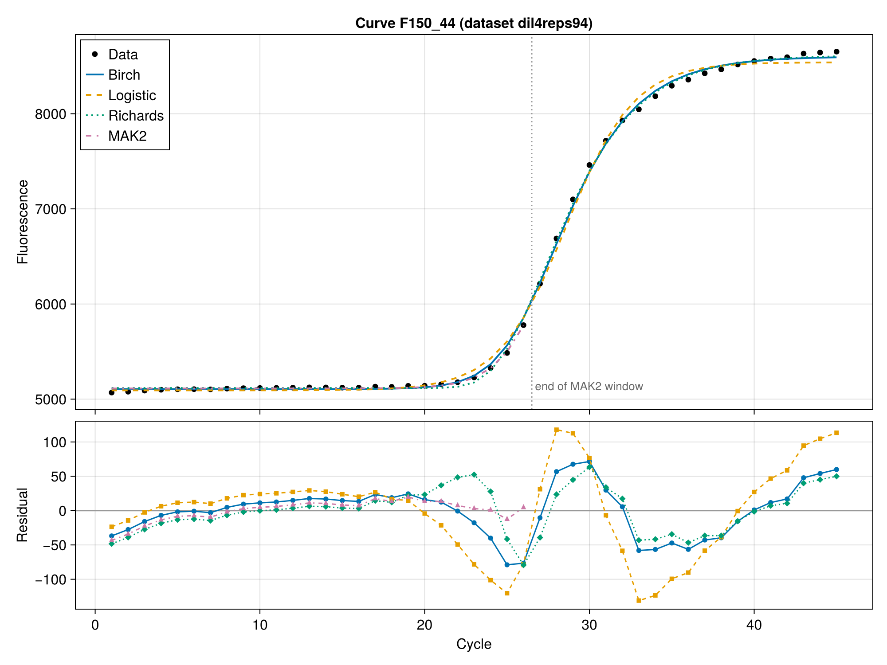

# qPCRModels.jl

[](https://gschivre.github.io/qPCRModels.jl/dev/)
[](https://github.com/gschivre/qPCRModels.jl/actions/workflows/CI.yml?query=branch%3Amain)

`qPCRModels.jl` is a Julia package that fits qPCR fluorescence amplification curves with non-linear least squares. It implements:

| Model | Type | Fitted range | Non-linear parameters |
|---|---|---|---|
| `BirchModel` | mechanistic | **whole curve** | $b$, $t_m$ |
| `MAK2Model` | mechanistic | exponential phase only (up to the SDM) | $x_0$ |
| `LogisticModel` | empirical (4PL) | whole curve | $a$, $t_m$ |
| `RichardsModel` | empirical (5PL) | whole curve | $a$, $t_m$, $\nu$ |

Every model has the form $F(c) = F_\mathrm{bg} + F_\mathrm{max} x(c)$, where $c$ is the cycle number. The baseline $F_\mathrm{bg}$ and scale $F_\mathrm{max}$ are linear parameters, eliminated by Variable Projection, so the Levenberg–Marquardt optimiser only searches over the non-linear parameters.

## Why the Birch model?

The Birch model is the default. It is derived from the PCR reaction scheme (primer annealing competing with template re-annealing), so its parameters have a physical meaning, and it fits the whole curve with only two non-linear parameters. It estimates the initial quantity $x_0$ with no standard curve, like MAK2, but it uses every cycle instead of the exponential phase only.



The [documentation](https://gschivre.github.io/qPCRModels.jl/dev/) gives the full derivation, a comparison of the four models on real data, and an explanation of why the Richards model cannot estimate $x_0$.

## Installation

```julia
using Pkg
Pkg.add(url = "https://github.com/gschivre/qPCRModels.jl")
```

## Quick start

```julia
using qPCRModels

ds = qpcRDataset("batsch1")  # built-in dataset
m = BirchModel(ds[:, 2])     # first curve
fit!(m)

get_x0(m)         # initial quantity n₀/K
get_stderrors(m)  # standard errors of the parameters
```

A command-line interface is also available:

```bash
julia --project=. bin/qpcr_fit.jl batsch1 --model birch -o results.csv
```

## Standalone executable (no Julia needed)

Each [release](https://github.com/gschivre/qPCRModels.jl/releases) includes a compiled version of the command-line tool for Linux and macOS. Extract the archive and run `bin/qpcr_fit` from the extracted folder:

```bash
tar xzf qpcr_fit-v0.1.0-linux-x64.tar.gz
qpcr_fit-v0.1.0-linux-x64/bin/qpcr_fit path/to/data.csv --model birch -o results.csv
```

See the documentation for absolute quantification with standard curves, all CLI options, how to build the executable yourself, and the API reference.

## License

The source code is released under the [MIT license](LICENSE). The benchmark datasets in `qpcR_datasets/` come from the R package [qpcR](https://cran.r-project.org/package=qpcR) and are distributed under its license, GPL (≥ 2); see [`qpcR_datasets/README.md`](qpcR_datasets/README.md) for their sources and citations.

## Acknowledgements

Part of this package was developed with the help of Claude, an AI coding agent made by Anthropic, used through Claude Code. Working with the author, Claude helped to:

* restructure the code as a standard Julia package, with CI, documentation and a command-line interface;
* fix the time scale of the MAK2 model and make the Birch and Richards fits robust on drifting curves;
* write the test suite and fix the bugs it found;
* add standard errors, calibration curves for absolute quantification and the REPL display of fitted models;
* write and check much of the documentation, including the written presentation of the Birch model derivation and the analysis of why the Richards model fails to estimate $x_0$.

The original package and its models were written by the author. The derivation of the Birch model from the PCR reaction scheme (the competition between primer annealing and template re-annealing, which gives $b = k_2/k_1 - 1$) is the author's original contribution; Claude only helped to write it up. The commits made with Claude carry a `Co-Authored-By: Claude` line in the git history.
